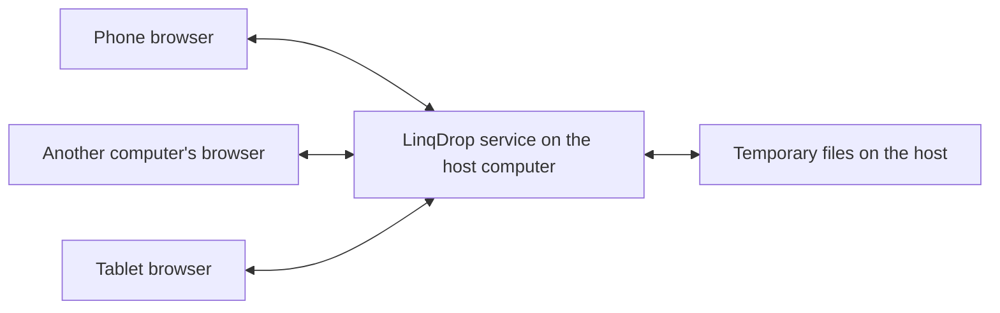

# LinqDrop

**English** | [简体中文](README.zh-CN.md)

**Share files between nearby devices over your local network, using a browser.**

LinqDrop is an offline file transfer tool for phones, tablets, and computers on the same local network. Start the service on one computer, open its address on your other devices, choose a recipient, and send files. No account, mobile app, cloud server, or internet connection is required.

Current version: **2.0.1**. The server uses the Python standard library. All web assets, including the QR code library, are bundled with the project, so no third-party dependencies or frontend build steps are needed.

## Features

- **One launcher:** Double-click `LinqDrop.bat` on Windows to start the service and open the host console. Launching it again reuses the running service.
- **Multiple devices:** Transfer files between computers and phones, or between two phones, with multiple devices connected at once.
- **No access code by default:** Open the address or scan the QR code to join. The host can enable an access code, and the setting persists across restarts.
- **Online recipients only:** Device cards and the recipient dropdown show only browsers that are currently online.
- **Recipient approval:** Queue multiple files and approve individual transfers or a batch from the same sender.
- **Transfer controls:** View progress and pause, resume, or cancel uploads while keeping the sending page open. Each browser can upload up to two files at once.
- **Temporary storage:** Up to 2 GiB per file and 10 GiB of reserved space across uncleared transfers.
- **Host controls:** View network addresses and QR codes, check or repair Windows firewall access, export diagnostics, and stop the service.

## Requirements

| Component | Requirement |
| --- | --- |
| Host computer | Python 3.9 or newer; the computer and service must remain running |
| Operating system | Windows launcher included; startup script provided for macOS / Linux |
| Sending and receiving devices | A browser supporting `fetch`, `AbortController`, and modern JavaScript |
| Network | Devices on the same reachable Wi-Fi network, LAN, or hotspot |
| Dependencies | No `pip install`, Node.js, or frontend build required |

Automatic firewall checks and repair are available on Windows. On macOS / Linux, allow the service port through the system firewall yourself. Full operation on these platforms has not been verified on physical devices. The current web interface is in Chinese; English instructions below include key interface labels.

## Quick start

### 1. Download the project

Choose **Code → Download ZIP** on GitHub and extract the entire archive, or clone the repository:

```bash
git clone https://github.com/yafeiya/LinqDrop.git
cd LinqDrop
```

### 2. Start the service on your computer

**Windows:** Double-click `LinqDrop.bat` in the project folder, or run:

```powershell
py -3 launcher.py
```

**macOS / Linux:**

```bash
sh start-macos-linux.sh
```

The launcher opens the host console in your browser. Its default address is:

```text
http://127.0.0.1:8765/
```

The default port is `8765`. If another application is using it, the launcher selects an available port from the following ports. Use the address displayed in the console. Closing the browser page leaves the service running in the background; use **Stop service** (`停止服务`) in the host console to stop it.

### 3. Join from another device

1. **Connect your phone, tablet, or other computer to the same Wi-Fi network or LAN as the host.** A phone using only mobile data cannot reach the host's LAN address.
2. Scan the QR code shown on the host, or enter its full address in the browser, for example `http://192.168.1.100:8765/`.
3. Devices join automatically by default, without an access code. The IP address above is an example; use the actual address shown by your host.

`127.0.0.1` refers to the device you are currently using. Other devices must use the host's LAN IP address shown in the console.

### 4. Send and save files

1. Select the recipient under **Choose a receiving device** (`选择接收设备`).
2. Choose or drag in your files. You can select multiple files at once.
3. The recipient clicks **Accept files** (`接收文件`) to start the upload.
4. Once the transfer is ready, click **Download file** (`下载文件`) on the receiving device.
5. Check the browser's downloads list to confirm that the file was saved. Keep the page in the foreground during transfers on a phone.

The device list contains browsers that have opened the page and joined. Different browsers are treated as separate devices; tabs in the same browser share an identity. A device that explicitly leaves disappears on the next synchronization. After a disconnect or browser closure, it is hidden after approximately 25 seconds without a heartbeat and reappears when it comes back online.

## Optional access code

Open the host console on the host computer at `http://127.0.0.1:<port>/` to change **Require an access code** (`加入时需要访问码`).

| Setting | How new devices join |
| --- | --- |
| Off, the default | Open the LAN address or scan the QR code to join automatically |
| On | Enter the host's 8-digit access code, or scan the QR code containing it |

- The setting is saved in `.runtime/settings.json` and persists across service restarts.
- Turning the requirement back on or restarting the service generates a new code.
- When enabled, **Change access code** (`更换访问码`) generates a replacement code. Changing the code or toggling the requirement leaves already joined devices connected.
- After a service restart, browsers need to rejoin. With access codes disabled, refreshing the page joins automatically.
- Host control operations require a request from the local loopback address with the host management credential.

## How it works



The host serves the web interface, tracks online devices, and handles file transfers. After the recipient approves a transfer, the sender uploads the file in chunks to the host's temporary directory. The recipient can download the completed file from the host. Transfers between two phones also use the host as a relay, so it must remain running.

All pages and assets are served locally, with no CDN, online pairing service, or third-party analytics. GitHub stores and distributes the source code; running LinqDrop does not require access to GitHub.

## If your phone cannot open the page

Check these in order:

1. **Connect to Wi-Fi.** Make sure the phone and host are on the same LAN rather than using mobile data alone. You can also connect all devices to the same phone hotspot.
2. **Use the current address.** Enter the complete `http://<host-lan-ip>:<port>/` shown by the host. Check it again after changing networks or adapters.
3. **Allow inbound connections.** On Windows, click **Fix phone access** (`修复手机访问`) in the host console and approve the Windows administrator prompt. This adds an inbound rule limited to the current Python program, LAN IP, TCP port, and `LocalSubnet`.
4. **Check proxies and network isolation.** VPNs, proxies, and browser acceleration features must allow direct LAN access. Guest Wi-Fi, AP isolation, or managed network policies can block communication between devices.
5. **Open the health endpoint.** Visit `http://<host-ip>:<port>/api/health`. A JSON response containing the version means the HTTP service is reachable. If this address also keeps loading, check the connection, address, firewall, and proxy first.

Use **Export diagnostics** (`导出诊断`) in the host console to generate a report with adapter details, host-side HTTP checks, and firewall status. It excludes access codes, device tokens, download credentials, and file names. Firewall repair keeps the firewall enabled and preserves the network category; explicit block rules and organizational policies can still take precedence.

## File storage and transfer limits

- Maximum file size: **2 GiB**. Total reserved space for uncleared transfers: **10 GiB**.
- Uploads are written to disk in 1 MiB chunks; downloads are streamed.
- Pausing or resuming after a network interruption requires the sending page to retain the original file. Refreshing or closing that page loses the browser's file reference; cancel the old transfer and select the file again.
- Downloads support HTTP Range. Whether a browser offers resumable downloads depends on that browser.
- **Delivered** (`已送达`) means the complete file has reached the host. **Download initiated** (`已发起过下载`) does not confirm that it has been saved on the receiving device; check the browser's downloads list.
- The displayed SHA-256 is calculated from the content received by the host and can be used for manual verification after download. It does not indicate that the sender and recipient have independently verified the file.
- Temporary files are cleaned up after 30 minutes without transfer activity, or when the service stops normally. A forced termination or power failure may leave a `linqdrop-hub-*` directory in the system temporary folder; remove it manually only after confirming that the service has stopped.
- **Clear** (`清理`) deletes the corresponding temporary file and prevents either party from downloading it. **Hide completed records** (`隐藏已结束记录`) only changes the current page's display.

## Privacy and local state

LinqDrop uses HTTP and temporarily relays files through the host computer. Use it on a trusted LAN, and enable the access code when you want to control new devices joining.

Browser identity is stored in that browser's local site storage. Device and transfer state lasts only for the current service session. The application does not provide arbitrary disk browsing, arbitrary command execution, or public internet forwarding.

`.runtime/` stores local startup state, logs, diagnostics, and the access-code setting. It is excluded from the repository through `.gitignore`. Transfer files are stored in the system temporary directory.

## Command-line usage

```bash
python launcher.py                       # Start the service and open the console
python launcher.py --no-browser          # Start without opening a browser
python launcher.py --port 9000           # Prefer the specified port
python launcher.py --stop                # Stop the service started from this folder
python launcher.py --diagnose            # Export network diagnostics
python server.py --port 8765 --no-browser # Run the server in the foreground
```

Use `python3` instead of `python` on macOS / Linux as appropriate for your installation. The compatibility entry point `start-windows.bat` uses the same launcher.

## Project structure

```text
LinqDrop/
├── LinqDrop.bat          # Windows launcher
├── start-windows.bat     # Windows compatibility entry point
├── start-macos-linux.sh  # macOS / Linux startup script
├── launcher.py          # Start, reuse, stop, and diagnose the service
├── server.py            # HTTP server, device presence, and file transfers
├── network_info.py      # Network adapters and LAN address selection
├── system_tools.py      # Firewall checks, repair, and network diagnostics
├── public/
│   ├── index.html       # Web interface
│   ├── app.js           # Joining, recipients, and transfer interactions
│   ├── style.css        # Desktop and mobile styles
│   └── lib/qrcode.js    # Bundled QR code library
├── LICENSE-qrcode.txt   # Third-party QR code library license
├── README.md            # English documentation, displayed by default
└── README.zh-CN.md      # Chinese documentation
```

## Validation

Version 2.0.1 has undergone server, frontend logic, and installation checks on Windows with Python 3.10. Coverage includes access-code setting persistence, online recipient filtering, bidirectional transfers, byte-for-byte file comparisons and SHA-256, pause/resume, HTTP Range, and host control permissions.

Frontend logic checks use the actual scripts with a simulated DOM and a real HTTP service. They are not physical-device tests across all mobile browsers. Operation on macOS / Linux, and device-specific QR scanning, file selection, and saving behavior, still need verification on the corresponding devices.

## License

The third-party QR code library's MIT license is included in [LICENSE-qrcode.txt](LICENSE-qrcode.txt). That file applies to the corresponding third-party code. A license for the project as a whole has not been specified.
