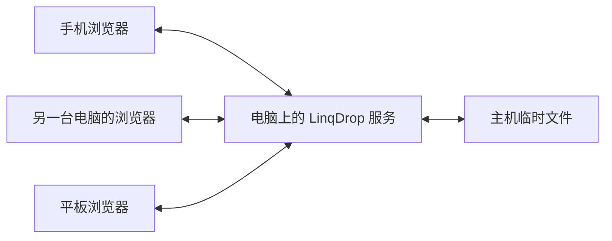

# 邻传 LinqDrop

[English](README.md) | **简体中文**

**在同一个局域网里，用浏览器把文件传给身边的设备。**

LinqDrop 是一款离线运行的局域网跨设备文件互传工具。一台电脑启动本地服务，手机、平板和其他电脑打开同一个地址加入，选择接收设备后即可互传。无需账号、手机 App、云服务器或外网连接。

当前版本：**2.0.1**。服务端使用 Python 标准库，网页和二维码库均随源码提供，无需安装第三方依赖。

## 主要功能

- **统一入口**：Windows 双击 `LinqDrop.bat` 启动服务并打开控制台，再次双击会复用正在运行的服务。
- **跨设备互传**：支持电脑与手机、手机与手机，以及多台设备同时加入。
- **默认免访问码**：打开地址或扫码即可加入；主机可开启“加入时需要访问码”，设置在重启后保留。
- **在线设备列表**：接收设备卡片和下拉框仅显示当前在线的浏览器。
- **接收前确认**：支持多文件排队，以及批量接收同一设备发来的文件邀请。
- **传输控制**：显示进度，支持在当前发送页面暂停、继续和取消；单浏览器最多同时上传两个文件。
- **临时中转**：单文件上限 2 GiB，主机临时文件总预留空间上限 10 GiB。
- **主机网络控制台**：显示访问地址、网卡和二维码，支持 Windows 防火墙检测与修复、诊断导出、停止服务。

## 运行要求

| 项目 | 要求 |
| --- | --- |
| 提供服务的电脑 | Python 3.9 或更新版本，保持开机并运行服务 |
| 操作系统 | Windows 提供双击入口；macOS / Linux 提供启动脚本 |
| 接收及发送设备 | 支持 `fetch`、`AbortController` 和现代 JavaScript 的浏览器 |
| 网络 | 所有设备连接可互相访问的同一 Wi-Fi、局域网或热点 |
| 安装依赖 | 无需 `pip install`、Node.js 或构建前端 |

Windows 防火墙自动检测和修复功能仅用于 Windows。macOS / Linux 上需自行允许相应端口；这些平台的完整操作尚未实机验证。

## 快速开始

### 1. 获取项目

在仓库页面选择 **Code → Download ZIP**，完整解压后使用；也可克隆：

```bash
git clone https://github.com/yafeiya/LinqDrop.git
cd LinqDrop
```

### 2. 在电脑上启动

**Windows**：双击项目根目录中的 `LinqDrop.bat`。

也可以在终端运行：

```powershell
py -3 launcher.py
```

**macOS / Linux**：

```bash
sh start-macos-linux.sh
```

启动器会打开主机控制台。默认地址为：

```text
http://127.0.0.1:8765/
```

默认端口为 `8765`。端口被占用时，启动器会选择后续可用端口，请以控制台显示的地址为准。关闭网页后，主机服务仍在后台运行；需要停止时点击控制台中的“停止服务”。

### 3. 让其他设备加入

1. 手机、平板和其他电脑**连接与主机相同的 Wi-Fi 或局域网**。只有移动数据连接时，无法访问主机的局域网地址。
2. 扫描主机页面上的二维码，或在浏览器地址栏输入主机显示的完整网址，例如 `http://192.168.1.100:8765/`。
3. 默认自动加入，无需输入访问码。上面的 IP 仅为示意，请使用你自己的主机地址。

`127.0.0.1` 代表当前设备自身，主机控制台会提供供其他设备使用的局域网 IP 地址。

### 4. 发送和保存文件

1. 在“选择接收设备”中选中接收方。
2. 选择文件，或拖入文件，支持一次选择多个文件。
3. 对方点击“接收文件”后开始上传。
4. 接收完成后，在接收设备点击“下载文件”。
5. 通过浏览器下载列表确认文件已经保存。手机传输时请保持页面在前台。

设备列表显示的是已经打开网页并加入的浏览器。不同浏览器视为不同设备；同一浏览器的多个标签页共用设备身份。离开后的设备在下一次同步时隐藏；断网或关闭浏览器后，约 25 秒无心跳会被隐藏，恢复在线后重新显示。

## 访问码开关

在主机电脑通过 `http://127.0.0.1:实际端口/` 打开控制台，可设置“**加入时需要访问码**”。

| 状态 | 新设备如何加入 |
| --- | --- |
| 关闭，默认状态 | 打开局域网地址或扫码后自动加入 |
| 开启 | 输入主机显示的 8 位访问码，或扫描包含访问码的二维码 |

- 开关保存在 `.runtime/settings.json`，服务重启后保留。
- 重新开启访问码或重启服务会生成新码。
- 开启时可点击“更换访问码”；切换开关和更换访问码均不影响已加入的设备。
- 服务重启后，浏览器需重新加入；免码模式下刷新页面即可自动加入。
- 主机控制操作只接受来自本机回环地址且持有管理凭据的请求。

## 工作原理



主机提供网页、设备在线状态和文件传输接口。发送方分块上传文件到主机临时目录；接收方确认后，可从主机下载文件。手机与手机互传也通过这台主机中转，因此主机必须保持运行。

所有页面和资源都在本地提供，不使用 CDN、在线配对或第三方分析。GitHub 用于保存和下载源码，运行工具时无需连接 GitHub。

## 手机打不开时

按顺序检查：

1. **手机已连接 Wi-Fi**：确认与电脑在同一局域网，避免仅使用移动数据。必要时让所有设备连接同一个手机热点。
2. **使用正确地址**：完整输入主机显示的 `http://局域网IP:端口/`，换 Wi-Fi 或网卡后重新查看地址。
3. **允许防火墙入站**：在主机控制台点击“修复手机访问”，按 Windows 提示授予管理员权限。该操作仅添加限定为当前 Python 程序、当前局域网 IP、实际 TCP 端口及 `LocalSubnet` 的入站允许规则。
4. **检查代理和网络隔离**：确认 VPN、代理或浏览器加速允许局域网直连；访客 Wi-Fi、AP 隔离和单位网络策略可能阻止设备互访。
5. **打开检测地址**：访问 `http://主机IP:端口/api/health`。能看到含版本号的 JSON 表示 HTTP 服务可达；若这个地址也一直加载，应先检查连接、地址、防火墙和代理。

可在主机控制台点击“导出诊断”。报告包含网卡、主机侧 HTTP 和防火墙检测结果，不包含访问码、设备令牌、下载凭据或文件名。防火墙修复不会关闭防火墙，也不会更改网络类别；显式阻止规则和组织策略仍可能优先。

## 文件保存与传输边界

- 单文件最大 **2 GiB**；所有未清理任务的总预留空间最大 **10 GiB**。
- 上传按 1 MiB 分块写入磁盘，下载使用流式读取。
- 暂停和网络恢复后的继续上传，要求当前页面仍保留原文件。刷新或关闭发送页面后，浏览器原文件引用会丢失，需要取消原任务并重新选择文件发送。
- 下载支持 HTTP Range；是否提供断点续传操作由接收方浏览器决定。
- 页面显示“已送达”表示文件已完整传入主机；“已发起过下载”不代表已保存到接收设备，请检查浏览器下载列表。
- 页面展示主机接收到内容的 SHA-256，可用于下载后人工核验。这不代表发送端和接收端已经完成独立校验。
- 临时文件在 30 分钟无传输操作后清理，正常停止服务也会清理。强制结束进程或断电后可能在系统临时目录留下 `linqdrop-hub-*` 文件夹；确认服务停止后可手动清理。
- “清理”会删除对应临时文件，使双方都无法再下载；“隐藏已结束记录”只影响当前页面的显示。

## 隐私与运行状态

工具使用 HTTP，并在主机电脑上临时中转文件，请在可信任的局域网使用。需要控制新设备加入时，可开启访问码。

浏览器设备身份保存在该浏览器的站点本地存储。设备和传输任务状态仅在本次服务运行期间保留。程序不提供任意磁盘浏览、任意命令执行或公网转发功能。

`.runtime/` 存放本机启动状态、日志、诊断和访问码开关设置；它已加入 `.gitignore`，不上传到仓库。临时传输文件位于系统临时目录。

## 命令行用法

```bash
python launcher.py                 # 启动并打开控制台
python launcher.py --no-browser    # 启动，不打开浏览器
python launcher.py --port 9000     # 优先使用指定端口
python launcher.py --stop          # 停止当前目录启动的服务
python launcher.py --diagnose      # 导出网络诊断
python server.py --port 8765 --no-browser  # 直接启动前台服务
```

macOS / Linux 上请按本机环境将 `python` 替换为 `python3`。兼容入口 `start-windows.bat` 会调用同一个启动器。

## 项目结构

```text
LinqDrop/
├── LinqDrop.bat          # Windows 统一入口
├── start-windows.bat     # Windows 兼容入口
├── start-macos-linux.sh  # macOS / Linux 入口
├── launcher.py          # 服务启动、复用、停止和诊断
├── server.py            # HTTP 服务、设备状态和文件传输
├── network_info.py      # 网卡检测与局域网地址选择
├── system_tools.py      # 防火墙检测、修复和网络诊断
├── public/
│   ├── index.html       # 网页界面
│   ├── app.js           # 加入、设备选择和传输交互
│   ├── style.css        # 桌面与手机样式
│   └── lib/qrcode.js    # 本地二维码库
├── LICENSE-qrcode.txt   # 第三方二维码库许可
├── README.md            # 英文主说明
└── README.zh-CN.md      # 中文说明
```

## 验证情况

2.0.1 在 Windows 和 Python 3.10 环境完成服务端、前端逻辑及安装检查，覆盖访问码开关持久化、在线设备过滤、双向传输、文件字节比对和 SHA-256、暂停/继续、HTTP Range 和主机控制权限。

前端逻辑检查使用实际脚本、模拟 DOM 和真实 HTTP 服务，不等同于所有手机浏览器的实机测试。macOS / Linux、不同手机的扫码、文件选择和保存行为仍需在对应设备上确认。

## 许可说明

第三方二维码库的 MIT 许可见 [LICENSE-qrcode.txt](LICENSE-qrcode.txt)。该文件适用于对应第三方代码；本项目尚未指定整体开源许可证。
